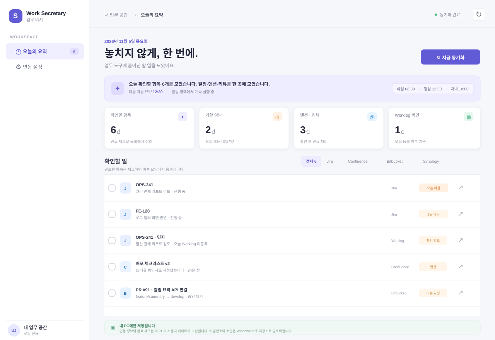

# SI Work Secretary

Windows 알림 영역(tray)에 상주하며 Jira, Confluence, Bitbucket, Synology Chat의 확인할 업무를 한 화면과 Windows 알림으로 모으는 개인 업무 비서의 첫 번째 구현입니다.



## 1차 구현 범위

- Windows 로그인 시 자동 시작하고 창을 닫아도 tray에 상주합니다.
- 매일 아침 08:30, 점심 12:30, 저녁 18:00에 Windows 알림을 보냅니다. 시간은 설정 화면에서 바꿀 수 있습니다.
- 지금 동기화, 알림 미리 보내기, 출처별 필터, 항목 완료 체크를 제공합니다.
- 아무 서버도 연결하지 않은 경우 샘플 데이터로 화면을 확인할 수 있습니다.
- Jira Server/Data Center, Confluence Server/Data Center, Bitbucket Server/Data Center, Synology Chat Server API를 각각 연결하는 어댑터를 포함합니다.
- 설정, 비밀정보, 완료 항목은 사용자별 Electron 데이터 디렉터리에 저장합니다. 비밀번호와 토큰은 Electron `safeStorage`로 암호화합니다.

## 실행

필요 환경: Windows 10/11, Node.js 24 LTS, npm.

```bash
npm install
npm start
```

Windows 설치 파일 생성:

```bash
npm run dist:win
```

설치 후 앱은 알림 영역에서 실행됩니다. 작업표시줄의 숨겨진 아이콘(∧)에서 `SI Work Secretary`를 열 수 있습니다. 앱 창을 닫아도 종료되지 않습니다. tray 메뉴의 **종료**로 완전히 종료합니다.

## 연결 방법

왼쪽 **연동 설정**에서 서버 주소와 인증 정보를 입력하고 각 서비스 스위치를 켠 뒤 저장합니다. URL에는 컨텍스트 경로가 포함될 수 있습니다(예: `https://jira.example.local/jira`). 자체 서명 인증서는 기본적으로 허용하지 않으므로 사내 인증기관(CA)을 Windows에 신뢰 루트로 설치해 주세요.

| 서비스 | 읽어오는 내용 | 연동 방식 / 참고 |
|---|---|---|
| Jira 9.12.4 | 나에게 할당되거나 내가 생성/Reporter인 미완료 이슈의 기한, 이슈의 Assignee/Reporter 중 오늘 Worklog가 없는 사용자 | `/rest/api/2/search`, `/rest/api/2/issue/{key}/worklog`. 추가 JQL을 설정해 리뷰 담당자 필드/업무 범위를 보완할 수 있습니다. |
| Confluence 8.5.0 | 최근 7일 이내 나를 멘션한 페이지/댓글 검색 결과 | CQL `mention = currentUser()`. 현재 사용자 컨텍스트로 인증해야 합니다. |
| Bitbucket 8.9.10 | 내가 리뷰어인 열린 Pull Request | `/rest/api/1.0/dashboard/pull-requests?role=REVIEWER&state=OPEN`. |
| Synology Chat | Bot이 볼 수 있는 채널에서 최근 7일 동안 `@here` 또는 설정된 내 이름/별칭을 포함한 메시지 | Chat의 `SYNO.Chat.External` Bot API. 선택한 채널 ID를 제한할 수 있습니다. |

인증은 사용자명/비밀번호 방식 또는 PAT(Bearer) 방식으로 입력합니다. 실제 인증 방식과 PAT 발급 가능 여부는 설치된 제품 설정과 사내 정책에 따라 달라질 수 있습니다. 가능하면 최소 권한의 읽기 전용 계정을 사용하세요.

## 데이터와 보안

- 서비스 API 요청은 Electron 메인 프로세스에서 사내 서버로 직접 전송합니다. 중간 서버나 클라우드에 데이터를 보내지 않습니다.
- API 비밀번호 및 PAT는 운영체제 보호 저장소를 사용하는 Electron `safeStorage`로 암호화합니다. 설정 파일에는 서버 주소/사용자명 등 비밀이 아닌 설정만 기록합니다.
- 완료 체크는 `userData/state.json`에 보관되어 다음 요약에서도 완료 항목을 숨깁니다.
- 기본 TLS 인증서 검증을 유지합니다. 인증서 검증을 끄지 말고 사내 CA를 PC에 신뢰하도록 구성하세요.
- Worklog 미등록은 현재 사용자가 관여하는 이슈의 Assignee와 Reporter를 기준으로, 해당 PC의 날짜 기준 오늘 기록을 조회합니다. Jira 프로젝트 권한·Worklog 가시성에 따라 일부 사람 또는 이슈가 결과에서 빠질 수 있습니다.
- 기본 Jira 검색 범위는 Assignee/Reporter입니다. Jira에는 모든 설치에서 공통으로 쓸 수 있는 리뷰어 필드가 없으므로, 리뷰어가 별도 커스텀 필드라면 연동 설정의 추가 JQL에 해당 조건을 넣어야 합니다.
- Synology Chat 메시지 조회는 Bot이 접근 가능한 채널만 가능합니다. `@` 멘션이 서버 응답에서 텍스트 형태로 제공되는지, 채널/메시지 반환 구조가 설치 버전에서 같은지는 실제 사내 서버로 확인이 필요합니다.

## 제품 API 참고

- [Jira Data Center REST API](https://developer.atlassian.com/server/jira/platform/rest/v10003/)
- [Confluence Data Center REST API와 CQL](https://developer.atlassian.com/server/confluence/advanced-searching-using-cql/)
- [Bitbucket Data Center REST API](https://developer.atlassian.com/server/bitbucket/rest/v803/)
- [Synology Chat Integration API](https://kb.synology.com/en-us/DSM/help/Chat/chat_integration?version=7)

## 구현 구조

```text
Windows tray / Notification
          │
     Electron Main ── API adapters ── Jira / Confluence / Bitbucket / Synology Chat
          │
     contextBridge IPC
          │
       Dashboard UI
          │
  userData (encrypted secrets + local state)
```

## 알려진 1차 범위와 다음 단계

- 아직 사내 서버 주소/계정으로 실제 연결 검증을 하지 않았습니다. 각 서비스 연결은 사내망에서 설정 후 확인해야 합니다.
- Jira의 “내가 리뷰어” 판정은 각 사내 프로젝트의 커스텀 필드/JQL 규칙을 추가로 확인해야 정확해집니다.
- Jira Worklog 확인은 첫 100개 이슈를 조회하고 이슈별 Worklog API를 호출합니다. 이슈가 많으면 JQL 범위를 좁히거나 일괄 Worklog endpoint로 개선하는 것이 좋습니다.
- Synology Chat `post_list`는 Bot이 채널별로 읽을 수 있는 메시지 범위와 서버 버전의 응답 스키마에 영향을 받습니다. 실제 서버에서 봇 권한과 멘션 표현을 확인한 뒤 파서 조정이 필요할 수 있습니다.
- 현재 Windows 설치 패키지는 소스에서 `npm run dist:win`으로 생성합니다. 코드 서명과 조직 배포는 인증서/배포 방식이 정해진 뒤 추가합니다.

## 화면 캡처

- [오늘의 요약 화면 예시](docs/screenshots/dashboard.svg)
- [업무 도구 연결 설정 화면 예시](docs/screenshots/settings.svg)

※ 첨부한 화면은 구현 UI를 바탕으로 한 정적 미리보기입니다. Windows에서 실행해 실제 시스템 알림과 서버 연동을 캡처한 결과는 아닙니다.
